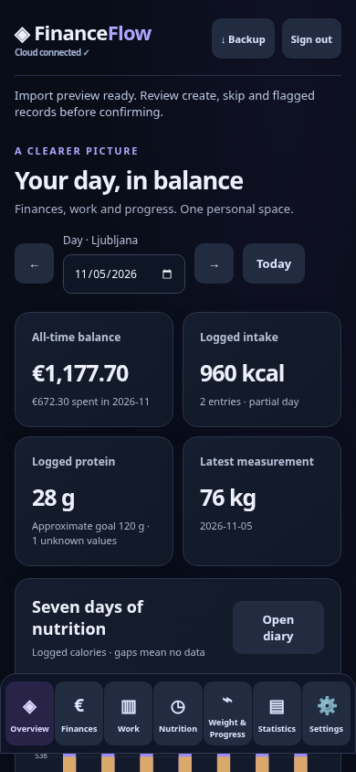
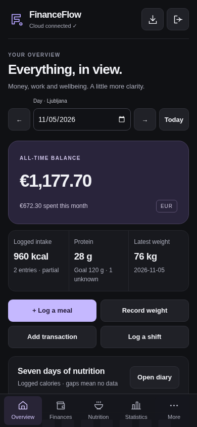

# FinanceFlow visual and UX review

This redesign covers Overview, Finances, Work, Nutrition, Weight & Progress, Statistics, Settings, sign-in, navigation and entry dialogs. It starts from main at `5c6b5b2` (merged PR #2). All screenshots use fictional records in a disposable local database. No personal dataset, production rows or example attachments are included.

## Problems found

- The inline stylesheet and v2 overrides competed for typography, spacing, colors and responsive rules. Cards had nearly equal visual weight, with gradients and large headings obscuring the important numbers.
- Seven mobile navigation destinations squeezed labels to 8–9px. Navigation consumed roughly 90px before safe-area allowance, while date controls and some secondary actions offered smaller touch targets.
- SVG charts used desktop viewboxes; labels could render at roughly 5–9px on phones. Simply checking document overflow missed these readability problems.
- The finance and work pages placed large forms ahead of existing activity. Transactions, shifts and progress were harder to scan than they needed to be.
- Nutrition summaries and provenance fields pushed the actual diary and useful entry fields too far down. Unknown protein read awkwardly as “Unknown g protein.”
- Mobile tables retained desktop columns and internal horizontal scroll. The historical import preview made the decision, record name and conflict reason difficult to inspect together.
- Settings mixed exports, profile forms and a long import workflow without a clear sequence. The file control could appear unselected even when a file remained loaded in memory.
- Success/status messages repeated connection information and could remain visible on unrelated pages. Numeric wrapping and intermediate resize states needed explicit stress tests.

The baseline visual harness recorded issues in 19 of 21 section/width combinations at 320, 390 and 1440px. These are combinations containing one or more small targets or unreadable chart labels, not 19 unique defects. The root document did not overflow; internal tables and small text were the main problems.

## Design system

The single stylesheet, [css/v2.css](../css/v2.css), defines the common system:

| Element | Decision |
| --- | --- |
| Canvas / surfaces | Neutral charcoal `#101114`, `#18191e`, `#202127`; restrained borders, no card gradients |
| Text | `#f1f2f6` primary, `#acaebc` secondary; system font stack with no font downloads |
| Accent | Muted violet `#b5a4ff`; pale violet primary buttons with dark text |
| Semantic states | Mint for positive/create, rose for negative/delete, warm amber for uncertainty/conflict; all have text labels |
| Spacing | Shared 4/8/12/16/20/24/32px tokens, compact layouts and consistent section rhythm |
| Shape / depth | 9px controls, 14px cards, 20px featured panels/dialogs; shadows reserved for overlays |
| Numbers | Tabular figures, deliberate hierarchy, full-width mobile cards for exceptionally large amounts |
| Interaction | At least 44px visible form/action targets, visible focus rings, native modal dialogs, reduced-motion support |
| Charts | Responsive geometry and ResizeObserver-maintained 12px screen labels without re-rendering unsaved forms |

Sampled contrast ratios are 15.69:1 for primary text, 7.97:1 for secondary text, 9.45:1 for primary buttons, 8.45:1 for create labels and 8.74:1 for conflict labels. These token checks are not a claim of a complete accessibility certification.

## Section changes

- **Overview:** one balance focal point, compact nutrition/weight strip, four immediate actions, quieter work/savings and nutrition panels. Existing totals and uncertainty explanations are retained.
- **Finances:** activity precedes forms, clear income/expense colors, readable transaction rows, compact filters and a top “Transaction” shortcut. Large amounts receive sufficient width instead of breaking between digits.
- **Work:** shifts precede entry/settings forms, mobile shift records have explicit field labels, and the work graph adapts to the available space. The top “Add shift” shortcut focuses the existing form.
- **Nutrition:** calories and protein remain prominent; goal and logging status become a compact context row. Diary rows separate meal identity, macros, uncertainty and actions. Catalog selection and extra macros/ranges are optional disclosure sections in the existing entry form; their values are still present and saved as before.
- **Weight & Progress:** consistent summaries, legible measurement/trend plots, and labeled mobile records in place of sideways table scrolling. Undated references stay distinct from measurements.
- **Statistics:** consistent date controls, responsive plots, semantic color labels and labeled mobile detail rows. Missing/unknown information and calculation rules are unchanged.
- **Settings:** grouped exports/preferences, quieter expandable finance-only backup controls and a three-step historical-import explanation.
- **Historical import:** decision counts, All/Create/Skip/Conflict filters, conflicts first, record cards with complete reasons and expandable identifiers, retained file-selection feedback, and confirmation after review. Sorting/filtering only affects the displayed copy of the preview. The insert plan and importer are unchanged.
- **Navigation / dialogs:** four mobile primary destinations plus More for Work, Weight and Settings; all seven remain in the desktop sidebar. Consistent SVG icons, focus cycling, Escape/backdrop dismissal, current-section indication, safe-area padding and keyboard-aware navigation. Advanced entry fields no longer dominate the default form.

## Before and after

Viewport captures preserve the actual fixed navigation. Import component captures hide the unrelated fixed navigation during the screenshot so it does not cut across the captured component. Screenshots contain synthetic data only.

| View | Before | After |
| --- | --- | --- |
| Mobile overview, 390px | [Before](visual/before-overview-390.png) | [After](visual/after-overview-390.png) |
| Desktop overview, 1440px | [Before](visual/before-overview-1440.png) | [After](visual/after-overview-1440.png) |
| Mobile historical import | [Desktop table on phone](visual/before-import-390.png) | [Filtered conflict cards](visual/after-import-390.png) |

### Mobile overview

 

### Other sections and states

- [Finances](visual/after-finance-390.png)
- [Work](visual/after-work-390.png)
- [Nutrition](visual/after-nutrition-390.png)
- [Weight & Progress](visual/after-weight-390.png)
- [Statistics](visual/after-statistics-390.png)
- [Settings on desktop](visual/after-settings-1440.png)
- [More navigation](visual/after-navigation-390.png)
- [Empty nutrition](visual/after-empty-390.png)
- [Entry editor on a 320px phone](visual/after-editor-320.png)
- [Large monetary values on a 320px phone](visual/after-large-values-320.png)

## Verification and scope

- `npm test`: all 28 existing calculation/import/auth-race/PostgreSQL cases pass.
- `npm run test:browser`: complete existing Chromium workflow passes, now using the real More sheet for secondary mobile destinations. Food edits/deletes/undo, catalog/recipes, weights, finance/work saves, statistics, private-file preview/repeat import, exports, offline failures and account switching remain covered.
- `npm run test:visual`: all seven sections at **320, 360, 390, 430, 768 and 1440px**, plus empty, populated, loading, error, long-label, large-number and short-viewport editor states. No document/control overflow, undersized visible action/form targets or chart labels below the test threshold remain in the matrix.
- Extended UI checks cover filter categories without writes, retained native file selection, modal keyboard cycling/Escape/focus restoration, secondary navigation, reduced motion, sampled contrast and simulated visualViewport keyboard geometry without losing unsaved input.
- JavaScript syntax checks and `git diff --check` pass. Before/after screens were inspected and iterated; failures involving undersized date controls, resized chart labels, keyboard focus and an invalid stress-test fixture were corrected.

No new dependencies were added. `js/core.js`, `js/importer.js`, Supabase migrations, authentication, RLS and write/import calculation behavior are unchanged. Test seeds run only in disposable PGlite. The service-worker shell version is bumped to `v2.1.0`; only its version changes. Manifest identity, start URL and scope are preserved; theme/background colors follow the new canvas.

Remaining checks before release: real Android safe-area/browser-toolbar/soft-keyboard behavior and installed-PWA updates, iOS/native date and file controls, and screen-reader/OS text-scaling checks. Chromium viewport emulation and simulated keyboard geometry do not replace those device checks. No deployment, production import or merge is performed by this PR.
