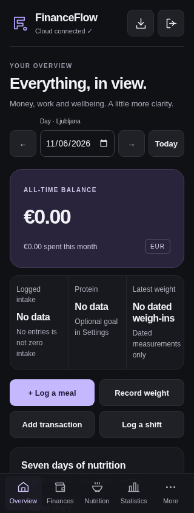

# Compatible PWA shell updates (v2.1.1 hotfix)

## Root cause and reproduction

PR #3 changed the HTML/icon/navigation contract, but HTML, CSS and application JavaScript still shared the same unversioned URLs as v2.0.1. The service worker fetched those files independently, updated individual cache entries, and used `ignoreSearch: true` for failures. Even a query-string version would therefore have matched an incompatible old cached asset. Public production HTML was still referencing `./css/v2.css` and `./js/app.js`; the observed GitHub Pages response used `Cache-Control: max-age=600`.

The prior clean-session tests did not exercise an installed old worker. `npm run test:pwa` now installs the actual v2.0.1 worker at `/FinanceFlow/`, loads its cache, then serves v2.1 HTML while the old stylesheet and app script fall back to that cache. It reproduces a **300px header icon, horizontal overflow, the old “Your day, in balance” heading, and old secondary tabs outside More**. It also reproduces a v2.1.0 worker installing a mixed precache from stale successful responses.

The snapshots under `tests/fixtures/releases/` contain only the public application files from main commits `5c6b5b2` and `7dbd50f`. They contain no personal nutrition, weight or finance records. All auth/API responses in the regression test are synthetic mocks; it does not contact production Supabase.

## Reproduction evidence

Both captures use Android Chrome emulation at 320px and synthetic empty account responses.

 

## Hotfix

- `npm run build:shell` creates content-hashed CSS/JS files in `shell/`, updates HTML to those exact URLs with Subresource Integrity, and generates `shell-release.json` plus the worker's matching public-asset manifest. Filenames, rather than query strings, bypass the old workers' path-based fallback rules.
- The release identifier is derived from the HTML, source assets, public static assets and worker logic. Future changes produce a new identifier automatically; developers do not manually edit cache names.
- Installation bypasses HTTP caches and verifies every response's SHA-256 before activating. A network error, stale 200 response or partial deployment rejects installation and preserves the previous active shell. Old FinanceFlow shell caches are removed only after a complete new shell installs.
- Once installed, the worker serves HTML and assets from its own verified release. It does not replace individual files from the live deployment. An evicted asset is repaired only if its hash still matches that release. There is no search-ignoring fallback for versioned assets.
- The allowlist includes only public shell assets. Supabase/auth requests, private import files, reports and user records are never added. Cleanup touches only `financeflow-shell-*` caches, not localStorage, IndexedDB or unrelated caches.
- Worker registration bypasses the HTTP cache. Online/resume events check for updates. A version handshake offers “Save any edits, then reload” when a different complete shell is ready. An open form is never reloaded automatically.
- SVG icons now have explicit dimensions, viewboxes and `fill="none"`/stroke attributes. The definitions SVG has inline zero dimensions. A small critical stylesheet bounds icons and secondary mobile navigation before the full stylesheet arrives.
- A cold reload of `#finance` or `#work` exposed another existing boot-order error (`round2` was used before initialization). Initial view navigation is deferred by one microtask, after the host script's render helpers initialize. No calculations, authentication or write handlers change.

## Future changes and deployment

1. Edit the canonical HTML/CSS/JS sources as usual. Keep `data-shell-source` on each local stylesheet/script dependency.
2. Run `npm run build:shell`. Commit the updated HTML, worker, release manifest and generated files along with the source changes. Existing hashed artifacts are not overwritten, preserving in-flight immutable URLs.
3. Run `npm test`, `npm run test:browser` and `npm run test:pwa`. `npm test` includes `check:shell`, so stale artifacts fail verification. The Shell compatibility GitHub Actions workflow runs these checks on pushes/PRs. It has no deployment or write permissions.
4. Review and merge using the normal production process. This hotfix does not merge or deploy itself. No database migration or import is required.

The source `js/core.js`, `js/importer.js` and Supabase migrations are unchanged. The normal finance, nutrition, weight and import workflows remain covered by the existing tests.

## Android recovery after deployment

Open the installed app online so the worker can download the complete compatible release. Then reload once, or close and reopen the app after the update finishes. A legacy open page may need that reload because its old JavaScript cannot display the new update notice. Later updates display the notice and wait for an explicit reload. There is no need to clear site data, sign out, reinstall, or delete any records.

Do not clear localStorage/IndexedDB as a cache-recovery step. If connectivity interrupts an update, the verified previous shell remains active until the complete update can install.

## Verification

- `npm test`: 28 existing calculation/import/auth-race/disposable-PostgreSQL cases.
- `npm run test:browser`: existing full authenticated-mock workflow, including finance/work records and saves, nutrition CRUD/undo, foods/recipes, weight, statistics, preview/repeated import, export and account switching.
- `npm run test:pwa`: actual v2.0.1 fallback reproduction; recovery from old and already-mixed v2.1.0 caches; fresh and upgraded layouts at 320/360/390/430px; all seven sections; offline shell; localStorage/IndexedDB/unrelated-cache preservation; interrupted and stale-response deployment rejection; automatic future-release invalidation; manual update with an unsaved form; finance/work deep-link reloads; and icon dimensions with CSS blocked entirely.
- `npm run test:visual`: existing 42 section/viewport combinations plus state/accessibility checks.
- Syntax checks, `npm run check:shell` and `git diff --check`.

The upgrade test saves ignored local screenshots under `test-results/pwa/`. Tests use Android Chrome user-agent/touch/mobile emulation with real service-worker lifecycles; an installed Android smoke check after the reviewed deployment remains necessary. No production data or production imports are used for verification.
